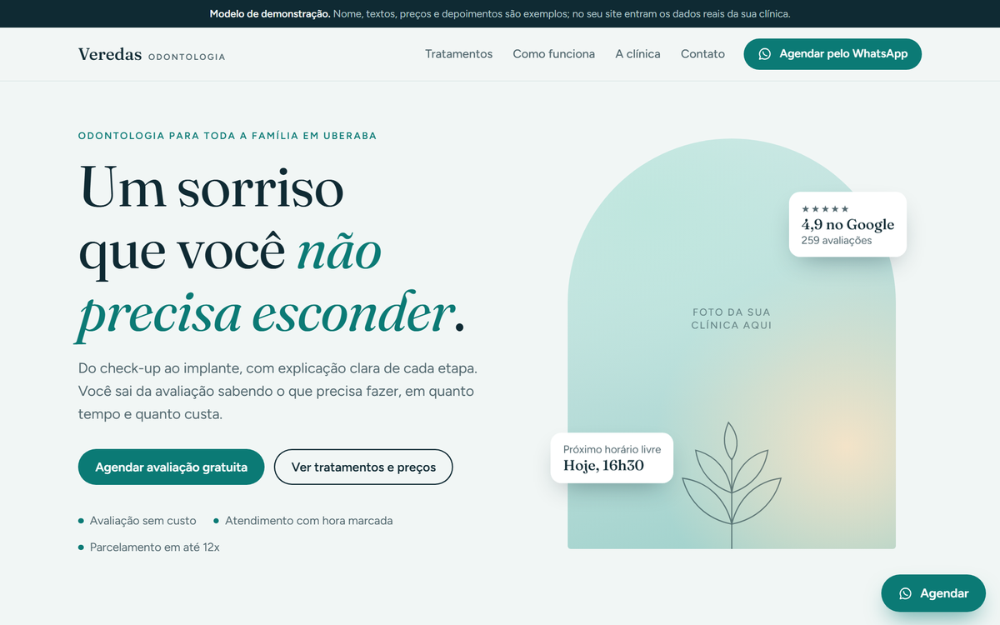

## Olá, eu sou o Gabriel

Desenvolvedor web em **Uberaba, MG**. Crio sites rápidos e bonitos para clínicas e pequenos negócios, além de bots e automações que tiram trabalho manual do dia a dia.

### O que eu faço

- **Sites e landing pages** que funcionam bem no celular, com botão de WhatsApp, lista de serviços, preços e localização.
- **Bots de Discord e Telegram**: fichas, comandos, moderação e automação de servidores.
- **Automações**: planilhas, scripts em Python e integrações entre ferramentas.
- **Jogos no Roblox** (Luau): sistemas de jogo, interface e salvamento de dados.

### Modelos de site

Sete modelos prontos para clínicas e consultórios: estética, odontologia, fisioterapia, psicologia, nutrição, podologia e veterinária. **[Ver todos no portfólio](https://uprodigy.github.io)**.

Os nomes e os dados são fictícios; no site de cada cliente entram o nome, as fotos e os serviços reais. Dois deles:

| Clínica de estética | Clínica odontológica |
|---|---|
|  |  |
| [Ver o site funcionando](https://uprodigy.github.io/clinica-lume/) | [Ver o site funcionando](https://uprodigy.github.io/veredas-odontologia/) |

### Como eu trabalho

1. Conversamos sobre o que você precisa, e eu confirmo por escrito o que será entregue, o prazo e o preço.
2. Em poucos dias mostro uma primeira versão para você opinar.
3. Entrego tudo funcionando, com instruções simples, e fico disponível para ajustes.

### Ferramentas

HTML · CSS · JavaScript · Python · Luau · GitHub Pages · Discord API

### Contato

Para orçamento, me chame pelo [99Freelas](https://www.99freelas.com.br) (usuário **uProdigy**).
